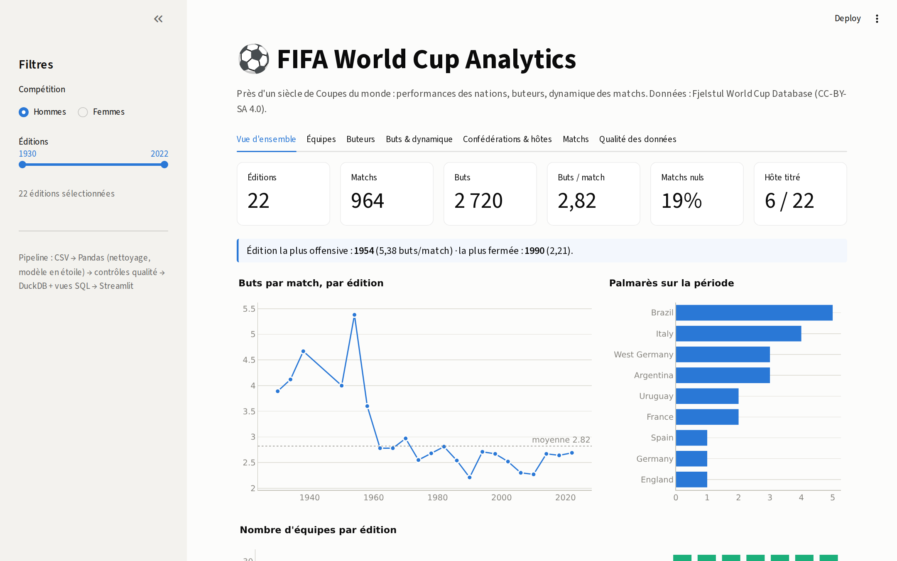
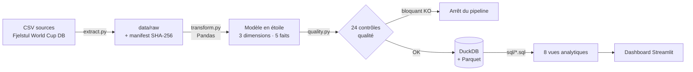
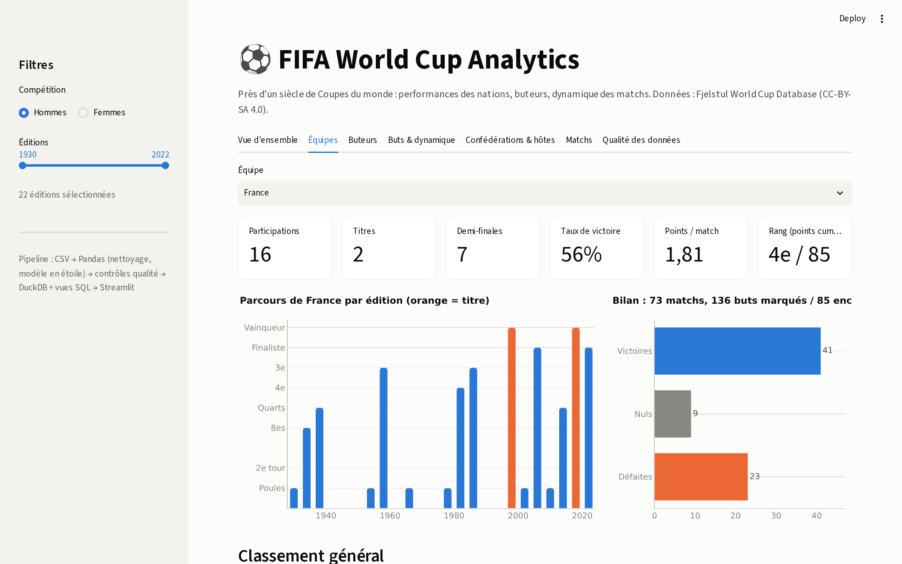

# ⚽ FIFA World Cup Analytics

Projet data de bout en bout : **pipeline de traitement de données** (Python + SQL) et **tableau de bord interactif** (Streamlit) sur l'historique des Coupes du monde FIFA masculines (1930 → 2022) et féminines (1991 → 2019).



## Objectifs

- Construire un pipeline reproductible **extraction → nettoyage → modélisation → contrôles qualité → chargement**.
- Modéliser les données en **schéma en étoile** dans un entrepôt analytique (DuckDB) et exposer les indicateurs via des **vues SQL**.
- Restituer les analyses dans un **dashboard** filtrable, pensé pour répondre à des questions métier :
  - Quelles nations dominent l'histoire de la compétition, et avec quelle régularité ?
  - Le football de Coupe du monde est-il devenu plus fermé ?
  - Quand les buts sont-ils marqués ? Les matchs à élimination directe sont-ils plus serrés ?
  - Le pays organisateur bénéficie-t-il d'un avantage ?
  - Comment évolue le poids des confédérations ?

## Architecture



| Étape | Fichier | Rôle |
|---|---|---|
| Extraction | `src/fifa_pipeline/extract.py` | Téléchargement des 8 fichiers CSV, manifeste (nb lignes, empreinte SHA-256) |
| Transformation | `src/fifa_pipeline/transform.py` | Nettoyage, typage, règles métier, construction du modèle en étoile |
| Qualité | `src/fifa_pipeline/quality.py` | Contrôles d'unicité, complétude, intégrité référentielle, cohérence, validité |
| Chargement | `src/fifa_pipeline/load.py` | Export Parquet, tables DuckDB, création des vues SQL |
| Orchestration | `src/fifa_pipeline/run.py` | Enchaîne les étapes, stoppe si un contrôle bloquant échoue |
| Restitution | `app/streamlit_app.py` | Dashboard 7 onglets |

## Traitement des données

**Nettoyage et règles métier appliquées**

- Harmonisation des libellés de phase incohérents dans la source (`quarter-final` / `quarter-finals`, `semi-final` / `semi-finals`) et traduction en français, avec un ordre de progression (`stage_order`).
- Valeurs `not available` / `not applicable` converties en valeurs manquantes ; dates et booléens typés.
- Séparation des compétitions **Hommes / Femmes**.
- Calcul du **vainqueur réel d'un match**, y compris aux tirs au but.
- **Barème 3/1/0 appliqué à toutes les éditions** pour comparer les époques (la victoire valait 2 points avant 1994).
- Tranches de minutes de but (0-15, …, 76-90, prolongations), repérage des buts dans le temps additionnel.
- Poste principal de chaque joueur dérivé des indicateurs de poste.

**Modèle en étoile**

| Table | Grain | Lignes |
|---|---|---:|
| `dim_tournament` | une édition | 30 |
| `dim_team` | une sélection | 88 |
| `dim_player` | un joueur / une joueuse | 10 401 |
| `fact_match` | un match | 1 248 |
| `fact_team_match` | une équipe dans un match | 2 496 |
| `fact_goal` | un but | 3 637 |
| `fact_standing` | top 4 d'une édition | 120 |
| `fact_host` | un pays hôte d'une édition | 31 |

**Vues SQL** (`sql/`) : `v_tournament_kpis`, `v_team_tournament`, `v_team_all_time`, `v_top_scorers`, `v_goal_timing`, `v_host_performance`, `v_confederation_tournament`, `v_matches`.

**Contrôles qualité** : 24 contrôles, dont la cohérence entre le détail des buts et le score de chaque match, un seul résultat (V/N/D) par équipe, le vainqueur du tournoi égal au 1er du classement, et les matchs compris dans les dates du tournoi. Résultat : 23/24 réussis, 1 alerte non bloquante (78 joueurs sans date de naissance). Rapport complet : [`reports/data_quality.md`](reports/data_quality.md).

## Dashboard

| Onglet | Contenu |
|---|---|
| Vue d'ensemble | KPI (matchs, buts, buts/match, % nuls), évolution des buts par match, palmarès |
| Équipes | Fiche nation : parcours par édition, bilan V/N/D, classement général en points par match |
| Buteurs | Top buteurs (jeu vs penalty), buts par poste, distribution |
| Buts & dynamique | Minutes des buts, buts par match, intensité selon la phase, penalties et CSC |
| Confédérations & hôtes | Poids des confédérations, effet pays hôte (domicile vs autres éditions) |
| Matchs | Explorateur filtrable des 1 248 matchs, export CSV |
| Qualité des données | Résultat des contrôles et volumétrie du modèle |

Filtres globaux : compétition (Hommes / Femmes) et période.



### Quelques enseignements (Coupe du monde masculine)

- **2,82 buts par match** en moyenne ; 1954 est l'édition la plus prolifique (5,38), 1990 la plus fermée (2,21).
- **21 % des buts** tombent dans le dernier quart d'heure du temps réglementaire, contre 13 % dans le premier.
- **Effet pays hôte** : 89 % des organisateurs font mieux à domicile que lors de leurs autres participations (+0,65 point par match en moyenne) ; 6 hôtes sur 22 ont été sacrés.
- L'UEFA et la CONMEBOL se partagent la quasi-totalité des places dans le dernier carré.

## Lancer le projet

```bash
git clone https://github.com/<votre-compte>/fifa-world-cup-analytics.git
cd fifa-world-cup-analytics
python -m venv .venv && source .venv/bin/activate   # Windows : .venv\Scripts\activate
pip install -r requirements.txt

python -m src.fifa_pipeline.run        # pipeline complet (< 2 s)
python -m pytest -q                    # tests
streamlit run app/streamlit_app.py     # dashboard sur http://localhost:8501
```

Avec `make` : `make pipeline`, `make test`, `make app`.

Si l'entrepôt n'existe pas encore, le dashboard lance lui-même le pipeline au démarrage : il peut donc être déployé tel quel sur [Streamlit Community Cloud](https://streamlit.io/cloud) (fichier principal : `app/streamlit_app.py`).

## Structure

```
fifa-world-cup-analytics/
├── app/streamlit_app.py          # dashboard
├── data/raw/                     # CSV sources + manifest.json (versionnés)
├── docs/                         # captures d'écran
├── reports/data_quality.md       # rapport qualité généré
├── sql/                          # vues analytiques DuckDB
├── src/fifa_pipeline/            # extract · transform · quality · load · run
├── tests/                        # tests pytest (transformations + qualité)
├── .github/workflows/ci.yml      # intégration continue
├── Makefile
└── requirements.txt
```

## Stack

Python 3.11 · Pandas · DuckDB (SQL) · Streamlit · Plotly · pytest · GitHub Actions

## Source des données

[The Fjelstul World Cup Database](https://github.com/jfjelstul/worldcup), Joshua C. Fjelstul, Ph.D., sous licence **CC-BY-SA 4.0**. Les fichiers de `data/raw/` sont redistribués sous cette même licence.

## Auteure

**Wafa Slimane Barkaoui** · Data Analyst / Consultante BI
